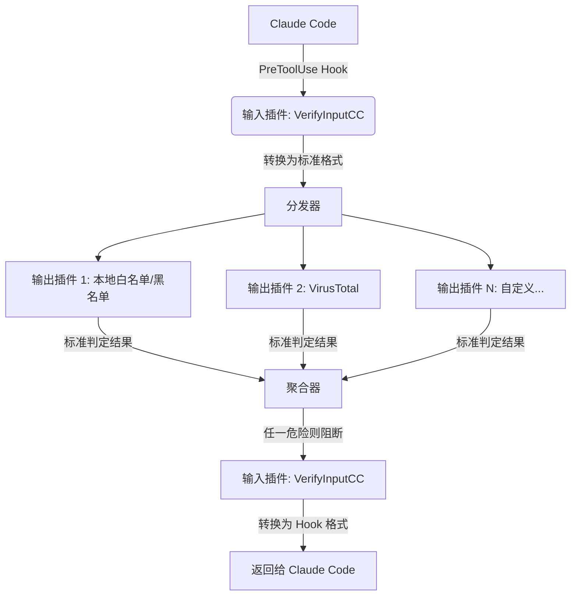

> 解决ClaudeCode WebFetch 因网络限制无法验证域名安全性的问题。提供可插拔、多源聚合的自动化验证方案。

# 问题背景

## 问题描述
在Web Fetch执行时会有如下错误：

```
Unable to verify if domain example.com is safe to fetch. This may be due to network restrictions or enterprise security policies blocking claude.ai.
```

根本原因是在ClaudeCode 执行 WebFetch 前，需要链接官方服务器验证目标域名的安全性，在受限网络环境等影响下，该链接会被阻断。

## 临时解决方案
临时的解决方案，是跳过验证web安全性的预检。.claude/settings.local.json文件中，添加如下内容：

```
{
  "skipWebFetchPreflight": true
}
```

**痛点**：跳过安全检查后，在claude code进行Web Fetch时，必须人工检查所有链接的安全性。

为此，本项目提供了一个基于java开发的安全验证服务。

# 核心特性
- 插件化架构：输入和输出完全解耦，并可通过插件动态扩展。方便扩展支持其他AI Agent工具和新的安全检查工具。
- 多源聚合评判：支持同时调用多个安全检查插件，采用一票否决机制---只要有一个来源判定危险，就阻断WebFetch

执行流程如下:



此程序的输入和输出，都采用插件的形式进行。这样是为了之后好扩展功能。


# 快速开始
## 构建程序
有两条路，下载已构建的程序，或者自己从源码构建程序。二选一。
### 方式1：下载已构建的程序
从releases页面下载已经构建好的程序包。

安装OpenJDK 25。这是程序必须的运行环境。


### 方式2：自己从源码构建程序，
本项目基于OpenJDK 25 + maven开发。请自行准备开发环境。

1. **构建核心库**：
先构建`Core/VerifyAPI`项目，并将其安装到本地maven仓库。

2. **构建插件**：
按需构建`Input/`和`output/`目录下的项目，将构建出的Jar放入`Core/VerifyV2/plugins/`目录下。

3. **构建主程序**
最后构建`Core/VerifyV2`项目生成可执行程序

可阅读项目里面的README作为参考。


# 免责声明
1. **工具定位**：本程序仅为安全验证请求的转发与多源结果聚合工具。自身不包含任何安全判定逻辑。

2. **结果来源**：所有安全判定结果均完全来自于本地白名单/黑名单配置，以及第三方检测API（如virustotal）。本工具不对检测结果的准确性、完整性或时效性做任何保证。

3. **责任豁免**：作者不承担任何因依赖本工具输出结果而直接或间接导致的安全问题、数据损失或业务中断责任。

4. **部署建议**：不建议在生产环境部署。本建议适用于所有AI Agent工具，而非仅针对本程序。

# 后续计划
> 仅为规划方向，尚未进入实施阶段。本项目是业余随性开发，无固定排期，更新时间不确定。

在设计程序之初，就已预留了对其他高危操作进行安全验证的扩展能力。以下为后续计划。

- [ ] 命令执行的安全检查：增加对Bash的PreToolUse拦截。验证即将执行的命令是否包含恶意特征或高危操作。
- [ ] 缓存机制：VirusTotal插件还并未做缓存机制。计划后续增加本地缓存，减少API调用频率并提升响应速度。
